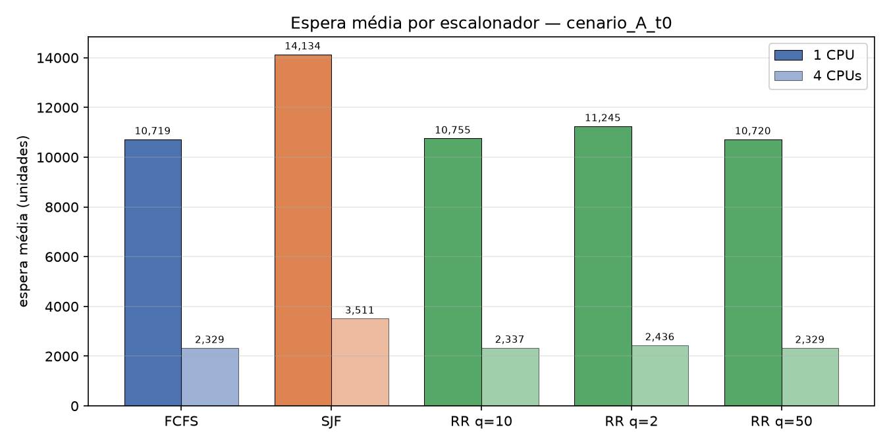
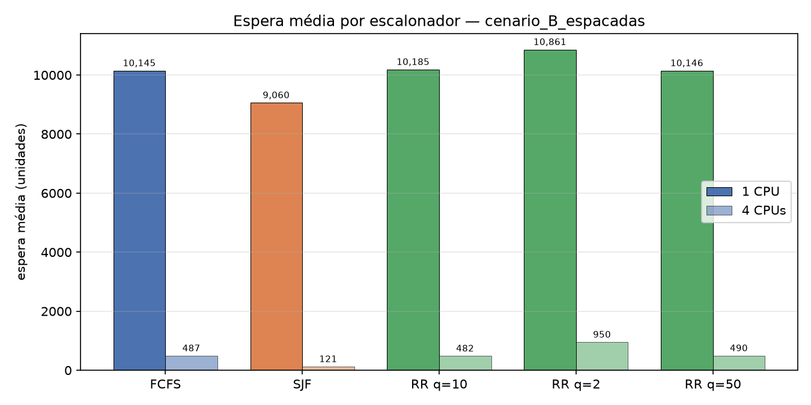
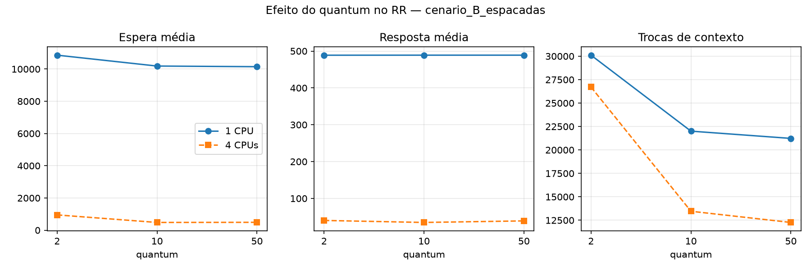
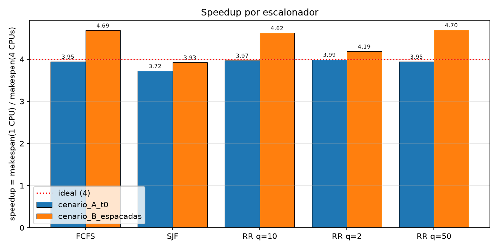
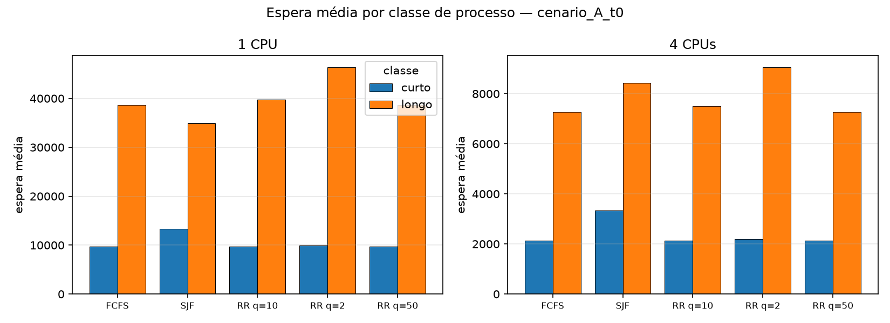
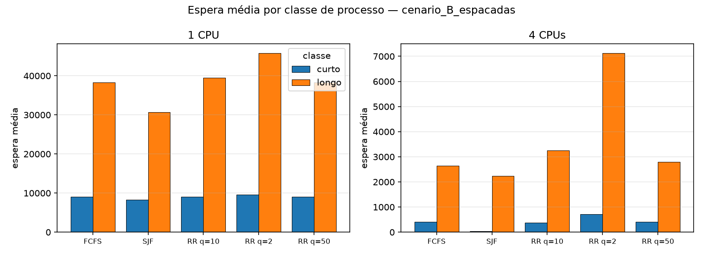
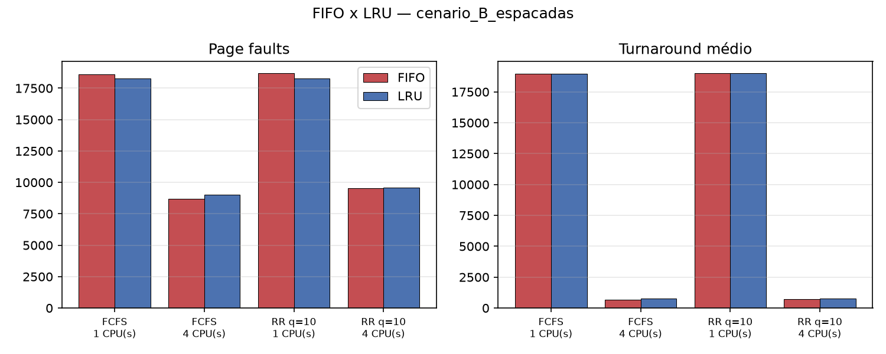
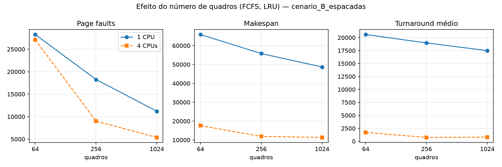

# 1. Introdução

Este relatório descreve o simulador desenvolvido pelo grupo, o desenho experimental
executado sobre os dois arquivos de carga fornecidos pelo professor (grupo 5) e a
análise crítica dos resultados. O simulador integra escalonamento de CPU (FCFS, SJF
não preemptivo e Round Robin) com memória paginada sob demanda (substituição global
FIFO ou LRU), em máquinas com 1 e com 4 CPUs que compartilham uma única fila de
prontos, seguindo exatamente as regras da seção 6 do enunciado.

Todos os números citados no texto vêm dos arquivos gravados em `resultados/`
(um JSON de métricas e um CSV de Gantt por execução, mais as tabelas resumo). Cada
afirmação cita a execução pelo nome do seu arquivo de configuração, no formato
`<escalonador>[_q<quantum>]_cpus<N>_<subst>_<quadros>quadros_troca1`, e a métrica
que a sustenta.

# 2. O simulador

## 2.1 Organização e execução

O simulador foi escrito em Python 3 usando apenas a biblioteca padrão; `matplotlib`
é usada só para os gráficos e `pytest` só para os testes.

| Arquivo | Função |
|---|---|
| `simulador.py` | O simulador. Lê o JSON, executa, imprime o resumo padronizado (seção 9.1), grava o Gantt 0–200 (9.2) e, com `--log`, o log de estados (9.3). |
| `experimentos.py` | Roda o desenho experimental da seção 11 em paralelo e monta as tabelas resumo. |
| `graficos.py` | Gera os gráficos e as figuras de Gantt a partir de `resultados/`. |
| `tests/test_exemplos.py` | 14 testes automatizados com os exemplos das seções 5.4, 5.5, 7.1 (FCFS, SJF e RR q=2), 7.2 e 7.3 e com casos de borda. |
| `cargas/` | `cenario_A_t0.json` e `cenario_B_espacadas.json` do grupo 5. |
| `resultados/`, `figuras/` | Saídas de todas as execuções e figuras do relatório. |

Todos os parâmetros são escolhidos na linha de comando, sem editar código
(seção 8 do enunciado): `--arquivo`, `--cpus`, `--sched {fcfs,sjf,rr}`,
`--quantum`, `--subst {fifo,lru}`, `--quadros` (padrão 256), `--custo-troca`
(padrão 1), `--fault` (padrão 20), `--log` e, para o log, `--log-max` e `--log-ate`. Exemplo:

```
python simulador.py --arquivo cargas/cenario_B_espacadas.json --cpus 4 \
    --sched rr --quantum 10 --subst lru --quadros 256 --custo-troca 1 --log
```

Ao final de cada execução o programa imprime o resumo padronizado com os
parâmetros, as métricas globais da seção 10.1, a tabela por CPU (útil, troca,
ocioso e porcentagens), os page faults e a taxa de faults (um exemplo completo está
no Anexo A). O Gantt é gravado em CSV no formato `cpu,inicio,fim,evento`, com uma
faixa por CPU. O log de estados registra, a cada evento, o evento e o pid, a fila
de prontos em ordem, os bloqueados com o instante de retorno, o processo em cada
CPU e os quadros ocupados (Anexo B).

## 2.2 Modelo de tempo e ordem dos eventos

O tempo é discreto. Em cada instante `t` o simulador executa, nesta ordem:

1. **Entradas na fila:** chegadas e retornos de E/S e de page fault, em ordem de pid.
2. **Fim de troca de contexto** e, no RR, **fim de quantum**: se há outro processo
   pronto, o atual vai para o fim da fila (depois dos que entraram no passo 1); se
   não há, continua sem custo e recebe novo quantum.
3. **Verificação da referência** dos processos em execução: um page fault libera a
   CPU no mesmo instante, sem consumir a unidade de CPU.
4. **Despachos**, CPU de menor índice primeiro. Um processo despachado sem custo de
   troca (mesmo processo que a CPU executou por último) verifica sua referência no
   mesmo instante; se dá fault, a CPU volta a ficar livre e despacha o próximo. Isso
   reproduz exatamente a sequência do exemplo 7.2 do enunciado.
5. **Avanço de `t` para `t+1`:** cada CPU acumula uma unidade em *útil*, *troca* ou
   *ocioso*, de modo que útil + troca + ocioso = makespan sempre.

Quando não há nenhum processo pronto nem CPU ocupada, o relógio salta diretamente
para o próximo evento (chegada ou retorno), contabilizando o intervalo como ocioso.

## 2.3 Escalonadores e troca de contexto

* **FCFS:** fila `deque`, atende na ordem de entrada.
* **SJF não preemptivo:** heap ordenado por `(parte restante do burst de CPU atual,
  ordem de entrada na fila)`, o que implementa o desempate "quem entrou primeiro".
  Usa o campo `cpu` do arquivo, nunca o campo `classe`.
* **RR:** a mesma `deque` do FCFS mais um contador de quantum por processo. Um page
  fault durante o quantum descarta o restante do quantum; o burst que termina antes
  do fim do quantum libera a CPU imediatamente.
* **Troca de contexto (Convenção A):** cobrada ao despachar um processo diferente do
  último que aquela CPU executou, inclusive no primeiro despacho. A CPU fica ocupada
  durante a troca e o processo é contado como "executando" (o tempo de resposta é o
  instante do despacho menos a chegada, como no exemplo 7.1). A troca não altera a
  memória.

## 2.4 Memória paginada: estrutura de dados e justificativa

A memória física é um único `OrderedDict` com chave `(pid, página)`, compartilhado
pelas CPUs, com no máximo `--quadros` entradas. A ordem das chaves é a informação
que as duas políticas precisam:

* **FIFO:** a ordem de inserção é a ordem de carga; a vítima é a primeira chave não
  protegida.
* **LRU:** cada acerto move a chave para o fim (`move_to_end`), de modo que o início
  do dicionário é sempre a página com a referência mais antiga; a vítima é a
  primeira chave não protegida.

Com isso, acerto, carga e remoção são O(1) e a busca da vítima só percorre as
páginas protegidas, que são no máximo uma por processo bloqueado em fault. Um
conjunto `protegidas` guarda as páginas carregadas por um fault cujo processo ainda
não reexecutou a referência, e um dicionário `pid → páginas` permite liberar todos
os quadros de um processo no término em tempo proporcional ao número de páginas
dele. A alternativa de varrer uma lista de quadros a cada referência custaria O(N)
por unidade de CPU; com 34.539 unidades de CPU e até 19 mil faults por execução, a
estrutura escolhida mantém cada execução entre 0,2 s e 3 s.

A regra da proteção foi implementada literalmente: no fault a página é trazida
imediatamente para um quadro (livre ou obtido por substituição) e fica protegida
até o processo voltar e repetir a referência, que então é acerto. Páginas de
processos em E/S ou na fila de prontos continuam na memória e podem ser vítimas. No
término do processo seus quadros são liberados.

## 2.5 Decisões de interpretação

Alguns pontos do enunciado admitem mais de uma leitura. As decisões adotadas estão
documentadas no `README.md` e são:

* **"Sem vítima":** quando todos os quadros estão protegidos, o processo fica
  bloqueado 20 unidades e tenta de novo. Interpretamos que a nova tentativa refaz o
  fault: se consegue um quadro, espera as 20 unidades da transferência; se não,
  espera mais 20 e tenta de novo. O fault é contado uma única vez; as retentativas
  são contadas à parte ("Retentativas sem vítima" no resumo).
* **Taxa de faults** = faults ÷ (acertos + faults), em que cada unidade de CPU
  executada é um acerto.
* **Gantt:** cada troca de contexto é um intervalo próprio no CSV, exatamente como
  no exemplo da seção 9.2.
* **`--fault 0`:** a página é carregada na hora e a execução segue (o fault é
  contado, mas não bloqueia). Serve só para reproduzir os exemplos "sem memória" do
  enunciado nos testes.

## 2.6 Validação

Os exemplos do enunciado foram feitos no papel e codificados como testes
(`python -m pytest -q tests`, 16 testes, todos passando):

| Teste | O que verifica | Valores conferidos |
|---|---|---|
| 5.4 | Processo 17 sem faults | turnaround 19, espera 0 |
| 5.5 | Processo 17 com faults | 4 faults, término em 441, turnaround 99 |
| 7.1 FCFS | Troca de contexto = 1 | esperas 0/6/8, turnarounds 6/10/11, makespan 13, CPU útil 10, troca 3, Gantt idêntico ao do enunciado |
| 7.1 SJF, RR q=2 | Exercícios propostos | SJF: esperas 7/0/2; RR: makespan 16, 6 trocas, Gantt completo |
| 7.2 | Faults, fila e CPU ociosa | esperas 0/0/0, turnarounds 12/12/6, 5 faults, útil 5, ocioso 8 |
| 7.3 FCFS e SJF | Fila que se forma após faults em paralelo | esperas 0/4/7 (média 3,67) e 5/2/0 (média 2,33) |
| Bordas | RR com fila vazia sem custo; volta de E/S na mesma CPU sem custo; 4 CPUs com menor índice primeiro; FIFO × LRU com 2 quadros; página protegida nunca é vítima; término libera quadros | — |

# 3. A carga de trabalho

Os dois arquivos do grupo 5 contêm os mesmos 1000 processos; só as chegadas
diferem. A tabela resume a caracterização feita diretamente sobre os JSONs.

| Característica | Valor |
|---|---|
| Processos | 1000: 964 curtos e 36 longos |
| CPU total da carga | 34.539 unidades (curtos 15.872, longos 18.667) |
| CPU por processo | curto: média 16,5 (2 a 37); longo: média 518,5 (285 a 745) |
| Bursts de CPU | 2.959; média 11,7, mediana 6, máximo 300 |
| Bursts de E/S | média 17,7 unidades (5 a 30); E/S total 34.716 |
| Páginas por processo | média 6,7 (4 a 32); curtos 6,1, longos 24,1; total 6.721 |
| Páginas distintas referenciadas | 5.373 (limite inferior de faults = faults compulsórios) |
| Localidade | em média 63 % das referências de um burst são a páginas distintas |
| Cenário A | todas as chegadas em t = 0 |
| Cenário B | chegadas de t = 0 a t = 9.076; 3,81 unidades de CPU por unidade de tempo = 95,1 % da capacidade de 4 CPUs |

Dois números orientam toda a análise. Primeiro, os 36 processos longos (3,6 % da
carga) respondem por 54 % do tempo de CPU e têm bursts de até 300 unidades.
Segundo, a carga referencia 5.373 páginas distintas, mas a memória padrão tem 256
quadros: nenhuma configuração consegue manter o conjunto de trabalho de muitos
processos ao mesmo tempo. Como cada unidade de CPU é um acerto, a menor taxa de
faults possível é 5.373 ÷ (34.539 + 5.373) = 13,5 %.

# 4. Desenho experimental

| Dimensão | Valores |
|---|---|
| Cenários | A (t = 0) e B (espaçadas) |
| CPUs | 1 e 4 |
| Escalonadores | FCFS, SJF, RR com quantum 2, 10 e 50 |
| Memória base | LRU, 256 quadros, custo de troca 1, fault 20 |
| FIFO × LRU | FCFS e RR q=10, com 1 e 4 CPUs, nos dois cenários (8 execuções, 4 por cenário) |
| Variação de quadros (opcional) | 64 e 1024 quadros, FCFS e RR q=10, FIFO e LRU, 1 e 4 CPUs |

O enunciado menciona "RR com 5 quantums" e 28 execuções base, mas a tabela da seção 11
lista só os quantums 2, 10 e 50; consultado, o professor confirmou esses três valores.
Por isso são 20 execuções base (2 cenários × 2 configurações × 5 variações), 8 de FIFO × LRU
e 32 de variação de quadros, num total de 60 execuções, todas reproduzidas por um
único comando (`experimentos.py`) em 7 s numa máquina de 12 núcleos (1m19s de CPU).
O speedup e a eficiência são calculados entre execuções com o mesmo escalonador,
quantum e memória, como manda a seção 10.1.

# 5. Resultados

## 5.1 Tabela resumo — cenário A (LRU, 256 quadros)

| Escalonador | CPUs | Espera média | Espera máx. | Turnaround médio | Resposta média | Makespan | Speedup | Eficiência | Trocas ctx | Utilização % | Ocioso total | Page faults | Taxa faults % |
|---|---|---|---|---|---|---|---|---|---|---|---|---|---|
| FCFS | 1 | 10719,38 | 50945 | 24239,49 | 499,5 | 56577 | — | — | 21988 | 99,91 | 50 | 19031 | 35,53 |
| SJF | 1 | 14133,99 | 43732 | 14354,36 | 7161,29 | 44981 | — | — | 9998 | 99,01 | 444 | 7056 | 16,96 |
| RR q=2 | 1 | 11245,42 | 58534 | 24644,37 | 499,5 | 64819 | — | — | 30280 | 100,0 | 0 | 18845 | 35,30 |
| RR q=10 | 1 | 10755,14 | 51523 | 24275,28 | 499,5 | 57297 | — | — | 22748 | 99,98 | 10 | 18995 | 35,48 |
| RR q=50 | 1 | 10719,53 | 50928 | 24239,63 | 499,5 | 56592 | — | — | 21992 | 99,89 | 61 | 19031 | 35,53 |
| FCFS | 4 | 2328,68 | 9454 | 6185,51 | 124,5 | 14339 | 3,946 | 0,986 | 21994 | 98,57 | 823 | 19044 | 35,54 |
| SJF | 4 | 3510,67 | 10825 | 3765,07 | 1775,25 | 12083 | 3,723 | 0,931 | 11624 | 95,51 | 2169 | 8676 | 20,08 |
| RR q=2 | 4 | 2436,36 | 11345 | 6295,70 | 124,5 | 16241 | 3,991 | 0,998 | 30161 | 99,59 | 264 | 18949 | 35,43 |
| RR q=10 | 4 | 2337,00 | 9653 | 6194,14 | 124,5 | 14441 | 3,968 | 0,992 | 22749 | 99,18 | 476 | 19022 | 35,51 |
| RR q=50 | 4 | 2328,68 | 9454 | 6185,52 | 124,5 | 14341 | 3,946 | 0,987 | 22000 | 98,56 | 825 | 19044 | 35,54 |

## 5.2 Tabela resumo — cenário B (LRU, 256 quadros)

| Escalonador | CPUs | Espera média | Espera máx. | Turnaround médio | Resposta média | Makespan | Speedup | Eficiência | Trocas ctx | Utilização % | Ocioso total | Page faults | Taxa faults % |
|---|---|---|---|---|---|---|---|---|---|---|---|---|---|
| FCFS | 1 | 10145,25 | 49603 | 18969,84 | 488,91 | 55790 | — | — | 21227 | 99,96 | 24 | 18268 | 34,59 |
| SJF | 1 | 9060,23 | 40460 | 9269,99 | 3829,36 | 44499 | — | — | 9492 | 98,95 | 468 | 6551 | 15,94 |
| RR q=2 | 1 | 10860,57 | 58048 | 19892,56 | 488,77 | 64650 | — | — | 30111 | 100,0 | 0 | 18381 | 34,73 |
| RR q=10 | 1 | 10185,31 | 50145 | 19010,39 | 488,91 | 56572 | — | — | 22006 | 99,95 | 27 | 18254 | 34,58 |
| RR q=50 | 1 | 10145,54 | 49584 | 18970,12 | 488,91 | 55810 | — | — | 21231 | 99,93 | 40 | 18268 | 34,59 |
| FCFS | 4 | 487,45 | 5003 | 748,85 | 40,62 | 11908 | 4,685 | 1,171 | 11966 | 97,63 | 1127 | 9009 | 20,69 |
| SJF | 4 | 120,72 | 7292 | 306,36 | 15,24 | 11337 | 3,925 | 0,981 | 8347 | 94,57 | 2462 | 5402 | 13,52 |
| RR q=2 | 4 | 950,12 | 9336 | 1296,68 | 40,26 | 15446 | 4,186 | 1,046 | 26708 | 99,13 | 537 | 12530 | 26,62 |
| RR q=10 | 4 | 481,59 | 5451 | 755,74 | 34,82 | 12234 | 4,624 | 1,156 | 13459 | 98,08 | 938 | 9572 | 21,70 |
| RR q=50 | 4 | 489,88 | 5122 | 756,50 | 39,06 | 11887 | 4,695 | 1,174 | 12265 | 98,44 | 744 | 9255 | 21,13 |

A tabela mostra os totais. As trocas de contexto, a utilização e o tempo ocioso de
cada CPU nas execuções com 4 CPUs estão no Anexo C (e no JSON de cada execução em
`resultados/<cenário>/`).

## 5.3 Gráficos

















As figuras equivalentes do outro cenário (`resposta_*`, `faults_*`, `quantum_cenario_A_t0`,
`fifo_lru_cenario_A_t0`, `quadros_cenario_A_t0`) estão em `figuras/`.

## 5.4 Diagramas de Gantt (janela 0–200, FCFS, LRU, 256 quadros)


No cenário B a janela 0–200 mostra o regime de início: CPUs ociosas (hachurado) nos
primeiros 20 instantes, enquanto os primeiros processos esperam seus faults
iniciais, e depois a alternância entre trocas de contexto (preto) e bursts curtos.
No cenário A, as duas figuras são inteiramente pretas, e isso é o comportamento
correto do modelo, não um defeito: os 1000 processos chegam em t = 0 com a memória
vazia, cada despacho custa 1 unidade de troca e a primeira referência de cada
processo é fault, o que libera a CPU sem consumir CPU. Assim as CPUs encadeiam 1000
trocas de contexto seguidas (250 por CPU com 4 CPUs). Os processos que voltam do
fault em t = 21 entram no fim de uma fila com centenas de processos à frente; a
primeira unidade útil de CPU com 4 CPUs ocorre em t = 251 (P1 na CPU 0, visível com
`--gantt-fim 600`) e com 1 CPU só em t = 1001. O log de estados (Anexo B)
mostra essa sequência evento a evento.

## 5.5 FIFO × LRU (256 quadros)

| Cenário | Escalonador | CPUs | Faults LRU | Faults FIFO | Makespan LRU | Makespan FIFO | Turnaround LRU | Turnaround FIFO |
|---|---|---|---|---|---|---|---|---|
| A | FCFS | 1 | 19031 | 19320 | 56577 | 56838 | 24239,49 | 24247,39 |
| A | FCFS | 4 | 19044 | 19365 | 14339 | 14404 | 6185,51 | 6181,70 |
| A | RR q=10 | 1 | 18995 | 19452 | 57297 | 57723 | 24275,28 | 24284,63 |
| A | RR q=10 | 4 | 19022 | 19455 | 14441 | 14555 | 6194,14 | 6189,03 |
| B | FCFS | 1 | 18268 | 18589 | 55790 | 56130 | 18969,84 | 18983,05 |
| B | FCFS | 4 | 9009 | 8697 | 11908 | 11881 | 748,85 | 689,62 |
| B | RR q=10 | 1 | 18254 | 18701 | 56572 | 56959 | 19010,39 | 19018,08 |
| B | RR q=10 | 4 | 9572 | 9557 | 12234 | 12214 | 755,74 | 725,05 |

## 5.6 Variação do número de quadros (FCFS, LRU)

| Cenário | CPUs | Quadros | Page faults | Taxa % | Makespan | Turnaround médio | Espera média | Utilização % | Ocioso total | Trocas ctx |
|---|---|---|---|---|---|---|---|---|---|---|
| A | 1 | 64 | 28493 | 45,20 | 66103 | 25034,62 | 3614,62 | 99,82 | 117 | 31447 |
| A | 1 | 256 | 19031 | 35,53 | 56577 | 24239,49 | 10719,38 | 99,91 | 50 | 21988 |
| A | 1 | 1024 | 12995 | 27,34 | 50493 | 25661,13 | 25316,03 | 100,0 | 0 | 15954 |
| A | 4 | 64 | 28612 | 45,31 | 17974 | 6294,99 | 414,83 | 91,94 | 5797 | 31560 |
| A | 4 | 256 | 19044 | 35,54 | 14339 | 6185,51 | 2328,68 | 98,57 | 823 | 21994 |
| A | 4 | 1024 | 12994 | 27,34 | 12768 | 6420,43 | 6075,34 | 98,86 | 580 | 15953 |
| B | 1 | 64 | 28276 | 45,01 | 65889 | 20593,37 | 3228,72 | 99,82 | 119 | 31231 |
| B | 1 | 256 | 18268 | 34,59 | 55790 | 18969,84 | 10145,25 | 99,96 | 24 | 21227 |
| B | 1 | 1024 | 11200 | 24,49 | 48698 | 17481,57 | 17174,15 | 100,0 | 0 | 14159 |
| B | 4 | 64 | 27103 | 43,97 | 17626 | 1709,05 | 256,78 | 91,62 | 5911 | 30054 |
| B | 4 | 256 | 9009 | 20,69 | 11908 | 748,85 | 487,45 | 97,63 | 1127 | 11966 |
| B | 4 | 1024 | 5373 | 13,46 | 11366 | 808,35 | 623,32 | 94,27 | 2606 | 8319 |

A tabela completa, com RR q=10 e FIFO, está em `resultados/quadros_<cenário>.md`.

# 6. Análise crítica

## 6.1 Uma máquina saturada: o custo da troca de contexto domina

Com 1 CPU as duas cargas saturam a máquina em qualquer escalonador: a utilização
fica entre 98,95 % e 100 % (tabelas 5.1 e 5.2). O dado mais revelador é a
decomposição do makespan. Em `fcfs_cpus1_lru_256quadros_troca1` do cenário A, as
56.577 unidades do makespan são 34.539 de CPU útil (a carga inteira), 21.988 de
troca de contexto e 50 ociosas: **39 % do tempo da CPU é gasto trocando de
contexto**. O mesmo vale para o cenário B (21.227 trocas em 55.790).

Isso acontece porque a troca de contexto e o page fault se realimentam: com 256
quadros para 5.373 páginas distintas, quase toda referência a uma página nova é
fault; cada fault devolve a CPU, e o próximo despacho é de outro processo e custa
mais uma troca. São 21.988 despachos pagos para 19.031 faults: quase um fault por despacho. A cada
fault, o processo volta para o fim de uma fila com até 1000 processos (`fila_max`
= 1000 no cenário A), e quando chega de novo à CPU suas páginas anteriores já foram
substituídas. Por isso a taxa de faults (35,5 %) é 2,6 vezes maior que o mínimo
compulsório (13,5 %).

O SJF escapa parcialmente desse ciclo: em `sjf_cpus1_lru_256quadros_troca1` do
cenário A são 9.998 trocas e 7.056 faults (16,96 %), perto do mínimo. O motivo é
que o processo que volta de um fault tem o mesmo burst restante de antes e, sendo
curto, é escolhido de novo quase imediatamente, enquanto suas outras páginas ainda
estão na memória. O resultado é o menor makespan de todos com 1 CPU (44.981 contra
56.577 do FCFS, −20 %) e um turnaround médio de 14.354 contra 24.239.

## 6.2 Quatro CPUs: speedup quase ideal no cenário A e superlinear no B

No cenário A o speedup fica entre 3,72 (SJF) e 3,99 (RR q=2), com eficiência de
0,93 a 1,00 (tabela 5.1, Figura 4). O ganho é quase ideal porque a máquina de 1 CPU
já estava 100 % ocupada e as 4 CPUs recebem o mesmo trabalho total: as trocas são
as mesmas (21.988 contra 21.994 no FCFS) e os faults também (19.031 contra 19.044).
O SJF perde um pouco (eficiência 0,931) porque sua vantagem com 1 CPU era reduzir
faults e trocas; com 4 CPUs há 2.169 unidades ociosas no fim da execução, quando só
restam os 36 processos longos e não há paralelismo suficiente para ocupar as CPUs.

No cenário B o speedup do FCFS é 4,685 e o do RR q=50 é 4,695, com eficiência
maior que 1. Um speedup superlinear não vem de "mais CPU", e sim de **menos
trabalho total**, como a decomposição do makespan mostra para
`fcfs_cpus1/cpus4_lru_256quadros_troca1`:

| | CPU útil | Troca | Ocioso | Soma | Makespan |
|---|---|---|---|---|---|
| 1 CPU | 34539 | 21227 | 24 | 55790 | 55790 |
| 4 CPUs | 34539 | 11966 | 1127 | 47632 | 47632 ÷ 4 = 11908 |

Com 4 CPUs há 9.261 trocas a menos e 9.259 faults a menos (9.009 contra 18.268).
As duas reduções têm a mesma causa: a fila é curta (`fila_max` 107 contra 372). Um
processo que volta de E/S frequentemente encontra uma CPU livre cujo último
processo foi ele mesmo, e aí não paga troca (regra 6.4); e, como poucos processos
disputam a memória ao mesmo tempo, suas páginas ainda estão lá quando ele volta.
O SJF não ganha isso (speedup 3,925) porque com 1 CPU ele já evitava a maior parte
dos faults (6.551) e das trocas (9.492); não havia sobrecarga a eliminar.

## 6.3 Escalonadores: a espera média não conta a história toda

No cenário B com 4 CPUs (tabela 5.2, Figura 2) o SJF tem a menor espera média
(120,72 contra 487,45 do FCFS e 481,59 do RR q=10), a menor resposta média (15,24)
e o menor turnaround (306,36 contra 748,85). Esse é o resultado clássico: com 964
processos curtos e 36 longos, atender primeiro o menor burst minimiza a espera
média, e aqui também evita faults (5.402, quase só os compulsórios).

No cenário A com 1 CPU, porém, o SJF tem a **maior** espera média (14.134 contra
10.719 do FCFS) e ao mesmo tempo o **menor** turnaround (14.354 contra 24.239).
Não há contradição: no FCFS cada processo passa a maior parte da vida bloqueado em
faults (que não contam como espera), enquanto no SJF, com um terço dos faults, os
processos passam esse tempo na fila de prontos. A métrica que mede o que o usuário
sente é o turnaround, e nele o SJF ganha em todas as quatro configurações. A mesma
armadilha aparece na variação de quadros (seção 6.6): com 64 quadros a espera média
cai para um terço, e o sistema está muito pior.

Entre FCFS e RR com quantum 10 ou 50 as diferenças são de menos de 1 % em todas as
métricas das tabelas 5.1 e 5.2 (por exemplo, makespan 56.577 contra 57.297 e 56.592
no cenário A com 1 CPU). Como a mediana dos bursts é 6 unidades e cada fault já
interrompe o processo, a preempção por quantum quase não acontece: 5 preempções
com q=50 e 794 com q=10 em 21 mil despachos. O RR só se diferencia do FCFS quando
os bursts são maiores que o quantum, o que é raro nesta carga.

## 6.4 Efeito do quantum no RR

A Figura 3 e as tabelas mostram que **q=2 é o único quantum que muda o
comportamento, e para pior**. No cenário B com 4 CPUs
(`rr_q2_cpus4_lru_256quadros_troca1`) as trocas sobem de 13.459 (q=10) para
26.708, o makespan de 12.234 para 15.446 (+26 %), a espera média de 481,59 para
950,12 e o turnaround de 755,74 para 1.296,68. Há 11.228 preempções por quantum
contra 932 com q=10 e 51 com q=50. Cada preempção custa uma troca, e com q=2 o
processo paga uma unidade de troca a cada duas de trabalho.

O quantum pequeno também piora a memória: com q=2 os faults sobem para 12.530
(26,6 %) contra 9.572 (21,7 %) com q=10, porque cada preempção devolve o processo
ao fim da fila e suas páginas ficam expostas à substituição por mais tempo.

O tempo de resposta médio é quase insensível ao quantum (40,26, 34,82 e 39,06 no
cenário B com 4 CPUs; 499,5 em todos os quantums no cenário A com 1 CPU). No
cenário A isso é aritmético: com 1 CPU o k-ésimo processo é despachado em t = k−1 e
a média de 0 a 999 é 499,5, qualquer que seja o quantum, porque todos dão fault no
primeiro acesso antes de qualquer quantum expirar. A escolha razoável para esta
carga é q=10: preserva a responsividade quando há bursts longos, sem a sobrecarga
de q=2 e sem degenerar em FCFS como q=50.

## 6.5 Injustiça, starvation e efeito comboio

**Injustiça contra os longos no SJF.** As Figuras 5 e 6 separam as classes. No
cenário B com 4 CPUs, o SJF dá aos curtos uma espera média de 42 unidades e aos
longos 2.230 (53 vezes mais), enquanto o FCFS dá 407 e 2.650 (6,5 vezes). O preço
da espera média baixa do SJF é concentrado nos 36 processos longos: a espera máxima
do SJF (7.292, pid 325) é maior que a do FCFS (5.003, pid 272), embora a média seja
quatro vezes menor.

**Starvation na prática.** Em `sjf_cpus1_lru_256quadros_troca1` do cenário A, o
processo 325 (longo, 580 unidades de CPU, maior burst 300, 32 páginas) só é
despachado pela primeira vez em t = 42.615, com o makespan em 44.981: ele esperou
95 % da execução inteira para começar, porque sempre havia um burst menor na fila.
A resposta média dos longos nessa execução é 29.082, contra 437 no FCFS. A inanição
não é infinita apenas porque a carga é finita e as chegadas param; num sistema com
chegadas contínuas de processos curtos, o processo 325 nunca executaria. O mesmo
processo é o de maior espera em todas as quatro execuções do SJF.

**Efeito comboio no FCFS.** No cenário B com 4 CPUs os processos curtos esperam em
média 407 unidades no FCFS contra 42 no SJF, quase 10 vezes mais, para a mesma
carga e a mesma máquina. A causa são os bursts de até 300 unidades dos processos
longos: enquanto um longo ocupa uma CPU, os curtos que chegaram depois ficam
enfileirados atrás dele e só saem quando ele termina o burst ou dá fault. O RR com
q=10 quebra o comboio nos bursts longos, mas nesta carga o ganho sobre o FCFS é
pequeno (espera dos curtos 378 contra 407) porque os faults já interrompem os
longos antes do quantum.

## 6.6 Thrashing e pressão de memória

Com 1000 processos e 256 quadros, o cenário A opera em **thrashing** no sentido
estrito: os processos passam mais tempo esperando páginas do que executando. Os
indicadores, em `fcfs_cpus1_lru_256quadros_troca1`:

* taxa de faults de 35,5 % contra o mínimo compulsório de 13,5 %, com 17.363
  substituições;
* 638.733 retentativas "sem vítima": com todos os quadros ocupados por páginas
  protegidas de processos bloqueados ou na fila, quem dá fault não consegue nem
  sequer um quadro e volta a dormir 20 unidades. Com 4 CPUs são 160.662 retentativas;
  no cenário B com 4 CPUs, zero, porque a fila é curta;
* turnaround médio de 24.239 para processos cujo CPU + E/S médio é de 69 unidades.

A variação de quadros (tabela 5.6, Figura 8) confirma o diagnóstico. Com 64 quadros
no cenário B e 4 CPUs (`fcfs_cpus4_lru_64quadros_troca1`), a taxa de faults vai a
44 %, as CPUs ficam ociosas 5.911 unidades (utilização 91,6 %) mesmo com 1000
processos para executar, e o turnaround médio mais que dobra (1.709 contra 749).
Esse é o sinal clássico de thrashing: aumentar a pressão de memória **reduz** a
utilização da CPU, porque os processos estão todos bloqueados em faults. Com 1024
quadros os faults caem exatamente ao mínimo compulsório (5.373, 13,46 %), não há
nenhuma substituição e FIFO e LRU produzem resultados idênticos.

No cenário A nem 1024 quadros bastam: os faults ficam em 12.995 (27 %), bem acima
dos 5.373 compulsórios, porque 1000 processos circulando numa fila FCFS referenciam
mais páginas do que cabem entre duas passagens pela CPU. É o padrão de acesso
cíclico maior que a memória, em que o LRU se comporta como FIFO e descarta
justamente a página que será usada em seguida.

O SJF é o único escalonador que não sofre "sem vítima" em nenhuma execução
(0 retentativas nas quatro), pelo mecanismo já descrito: o processo que volta de um
fault é reescalonado logo, libera a proteção da sua página e mantém o número de
páginas protegidas abaixo de 256.

## 6.7 FIFO × LRU

Nas oito comparações (tabela 5.5, Figura 7) a diferença entre as políticas é de menos
de 4 % em faults e de menos de 1 % em makespan e turnaround. O LRU tem menos
faults em seis das oito comparações, as quatro de 1 CPU e as duas do cenário A com 4 CPUs (por exemplo 19.031
contra 19.320 em `fcfs_cpus1`), mas o FIFO tem menos no cenário B com 4 CPUs (8.697
contra 9.009 no FCFS; 9.557 contra 9.572 no RR q=10), e ali o FIFO também tem
turnaround menor (689,62 contra 748,85).

A pequena diferença tem duas causas. A primeira é que a maior parte dos faults é
compulsória: 5.373 das 9.009 no cenário B com 4 CPUs, e nenhuma política evita o
primeiro acesso. A segunda é que a regra da proteção retira das duas políticas as
páginas mais recentes, e o que sobra para escolher a vítima são páginas de
processos na fila ou em E/S, para as quais "carregada há mais tempo" e "referenciada
há mais tempo" quase coincidem, porque a maioria dos processos executa poucas
unidades entre dois bloqueios. O caso do cenário B com 4 CPUs, em que o FIFO vence,
mostra que o LRU não é ótimo: quando o padrão de acesso de 100 processos
intercalados não tem localidade temporal entre passagens pela CPU, manter a página
"usada recentemente" não ajuda, e o FIFO, por ignorar os acertos, retira páginas de
processos que já saíram da CPU há mais tempo.

# 7. Limitações do modelo

* **O SJF conhece o futuro.** Ele usa o valor exato do campo `cpu` do próximo burst
  (ou da parte que falta). Num sistema real esse valor seria desconhecido e
  precisaria ser estimado, por exemplo por média exponencial dos bursts anteriores;
  os resultados do SJF são, portanto, um limite superior de desempenho.
* **Page fault de custo fixo e sem fila de disco.** Os bloqueados esperam em
  paralelo, cada um 20 unidades. Num sistema real 1000 faults simultâneos formariam
  fila no disco e o thrashing do cenário A seria ainda pior.
* **Troca de contexto de custo fixo e sem efeito na memória.** Não há cache nem TLB;
  a única "afinidade" é a regra de não pagar troca quando o mesmo processo volta à
  mesma CPU.
* **Memória sem endereços, offsets nem páginas compartilhadas**; um quadro guarda
  apenas a identidade (pid, página).
* **A regra de proteção com retentativa** é uma interpretação (seção 2.5). Outra
  leitura, em que a retentativa bem-sucedida não espera mais 20 unidades, reduziria
  o turnaround no cenário A, mas não mudaria as conclusões, já que o número de
  retentativas e de faults é o mesmo.
* **Referências e chegadas são sintéticas**, geradas pelo professor; a localidade
  real de programas tende a ser maior que os 63 % de páginas distintas por burst
  desta carga, o que favoreceria o LRU.
* **O log de estados** cresce com o número de eventos: no cenário A são mais de 700
  mil linhas. Por isso cada linha lista no máximo 20 pids por conjunto (com o total
  entre parênteses, `--log-max`) e `--log-ate T` grava só até o instante T, que é o
  modo indicado para a defesa.

# 8. Conclusões

1. Com 1 CPU, a troca de contexto consome 38–39 % do tempo em FCFS e RR, porque
   faults e trocas se realimentam (`fcfs_cpus1_lru_256quadros_troca1`, A e B).
2. Quatro CPUs dão speedup de 3,7 a 4,0 no cenário A e superlinear (até 4,7) no
   cenário B, porque a fila curta elimina metade das trocas e dos faults.
3. O SJF tem o menor turnaround em todas as configurações e os menores faults, mas
   à custa de inanição prática dos 36 processos longos (pid 325 esperou 95 % da
   execução para começar).
4. O FCFS sofre efeito comboio: os curtos esperam 10 vezes mais do que no SJF no
   cenário B com 4 CPUs.
5. No RR, q=10 e q=50 são indistinguíveis do FCFS nesta carga; q=2 dobra as trocas e
   aumenta o makespan em 13–26 % em relação a q=10.
6. Com 256 quadros para 5.373 páginas o cenário A opera em thrashing (35 % de
   faults, 638 mil retentativas sem vítima); com 64 quadros a utilização da CPU cai
   a 92 % mesmo com 1000 processos prontos, e com 1024 quadros o cenário B chega ao
   mínimo compulsório de faults.
7. FIFO e LRU diferem em menos de 4 % em faults, porque a maioria dos faults é
   compulsória e a regra de proteção neutraliza a diferença entre as políticas.

# 9. Reprodução

```
python3 -m venv .venv && .venv/bin/pip install -r requirements.txt
.venv/bin/python -m pytest -q tests
.venv/bin/python experimentos.py --cargas cargas/cenario_A_t0.json cargas/cenario_B_espacadas.json \
    --quantums 2 10 50 --quadros-extra 64 1024 --saida resultados
.venv/bin/python graficos.py --resultados resultados --saida figuras
```

O simulador é determinístico: as mesmas entradas produzem exatamente os mesmos
arquivos em `resultados/`.

# Anexo A — Resumo padronizado de uma execução

`python simulador.py --arquivo cargas/cenario_B_espacadas.json --cpus 4 --sched sjf --subst lru --quadros 256 --custo-troca 1`

```
==============================================================================
RESUMO DA EXECUÇÃO
==============================================================================
Parâmetros:
  arquivo=cargas/cenario_B_espacadas.json  cpus=4  sched=sjf  subst=lru  quadros=256  custo_troca=1  fault=20
  processos=1000  cpu_total_carga=34539  es_total_carga=34716
------------------------------------------------------------------------------
Métricas globais:
  Espera média        : 120.72
  Espera máxima       : 7292 (pid 325)
  Turnaround médio    : 306.36
  Resposta média      : 15.24
  Makespan            : 11337
  Trocas de contexto  : 8347 (preempções por quantum: 0)
  Utilização média    : 94.57%
  Tamanho máx. da fila: 35
  Classe curto : n=964  espera média=41.97  espera máx=300  turnaround médio=194.65  resposta média=7.13
  Classe longo : n=36  espera média=2229.50  espera máx=7292  turnaround médio=3297.72  resposta média=232.44
------------------------------------------------------------------------------
Por CPU:
  CPU     útil    troca   ocioso    útil%   troca%  ocioso%  utiliz.  trocas
    0     8698     2438      201   76.72%   21.50%    1.77%   98.23%    2438
    1     8568     2124      645   75.58%   18.74%    5.69%   94.31%    2124
    2     8562     2147      628   75.52%   18.94%    5.54%   94.46%    2147
    3     8711     1638      988   76.84%   14.45%    8.71%   91.29%    1638
------------------------------------------------------------------------------
Memória:
  Page faults totais  : 5402
  Referências totais  : 39941 (acertos + faults)
  Taxa de faults      : 13.52% (faults / referências)
  Substituições       : 34   Retentativas sem vítima: 0
==============================================================================
```

# Anexo B — Trecho do log de estados (`--log`)

Primeiros instantes da mesma execução. Cada linha traz o evento, a fila de prontos
em ordem, os bloqueados com instante de retorno, o processo em cada CPU e os
quadros ocupados.

```
t=0 | CHEGADA pid=1 | prontos=[1] | bloqueados={} | cpus=['-', '-', '-', '-'] | quadros=0/256
t=0 | DESPACHO pid=1 cpu=0 troca_ate=1 | prontos=[] | bloqueados={} | cpus=['P1(troca)', '-', '-', '-'] | quadros=0/256
t=1 | CHEGADA pid=2 | prontos=[2] | bloqueados={} | cpus=['P1(troca)', '-', '-', '-'] | quadros=0/256
t=1 | FAULT pid=1 cpu=0 pag=6 retorno=21 | prontos=[2] | bloqueados={1:21} | cpus=['-', '-', '-', '-'] | quadros=1/256
t=1 | DESPACHO pid=2 cpu=0 troca_ate=2 | prontos=[] | bloqueados={1:21} | cpus=['P2(troca)', '-', '-', '-'] | quadros=1/256
t=2 | CHEGADA pid=3 | prontos=[3] | bloqueados={1:21} | cpus=['P2(troca)', '-', '-', '-'] | quadros=1/256
t=2 | CHEGADA pid=4 | prontos=[4, 3] | bloqueados={1:21} | cpus=['P2(troca)', '-', '-', '-'] | quadros=1/256
t=2 | CHEGADA pid=5 | prontos=[5, 4, 3] | bloqueados={1:21} | cpus=['P2(troca)', '-', '-', '-'] | quadros=1/256
t=2 | FAULT pid=2 cpu=0 pag=4 retorno=22 | prontos=[5, 4, 3] | bloqueados={1:21, 2:22} | cpus=['-', '-', '-', '-'] | quadros=2/256
t=2 | DESPACHO pid=5 cpu=0 troca_ate=3 | prontos=[4, 3] | bloqueados={1:21, 2:22} | cpus=['P5(troca)', '-', '-', '-'] | quadros=2/256
t=2 | DESPACHO pid=4 cpu=1 troca_ate=3 | prontos=[3] | bloqueados={1:21, 2:22} | cpus=['P5(troca)', 'P4(troca)', '-', '-'] | quadros=2/256
t=2 | DESPACHO pid=3 cpu=2 troca_ate=3 | prontos=[] | bloqueados={1:21, 2:22} | cpus=['P5(troca)', 'P4(troca)', 'P3(troca)', '-'] | quadros=2/256
```

No SJF a fila é mostrada em ordem de despacho (menor burst primeiro): em t=2 o
processo 5 tem o menor burst e sai antes do 4 e do 3, embora tenha chegado depois.

# Anexo C — Métricas por CPU (execuções base com 4 CPUs)

Utilização = (útil + troca) ÷ makespan; ocioso = makespan − útil − troca. Em cada
linha, útil + troca + ocioso = makespan da execução.

**Cenário A (LRU, 256 quadros, 4 CPUs)**

| Escalonador | CPU | Útil | Troca | Ocioso | Útil % | Troca % | Ocioso % | Utilização % | Trocas |
|---|---|---|---|---|---|---|---|---|---|
| FCFS | 0 | 8704 | 5525 | 110 | 60,70 | 38,53 | 0,77 | 99,23 | 5525 |
| FCFS | 1 | 8607 | 5524 | 208 | 60,03 | 38,52 | 1,45 | 98,55 | 5524 |
| FCFS | 2 | 8692 | 5464 | 183 | 60,62 | 38,11 | 1,28 | 98,72 | 5464 |
| FCFS | 3 | 8536 | 5481 | 322 | 59,53 | 38,22 | 2,25 | 97,75 | 5481 |
| SJF | 0 | 9062 | 2770 | 251 | 75,00 | 22,92 | 2,08 | 97,92 | 2770 |
| SJF | 1 | 8679 | 2857 | 547 | 71,83 | 23,64 | 4,53 | 95,47 | 2857 |
| SJF | 2 | 8414 | 2960 | 709 | 69,64 | 24,50 | 5,87 | 94,13 | 2960 |
| SJF | 3 | 8384 | 3037 | 662 | 69,39 | 25,13 | 5,48 | 94,52 | 3037 |
| RR q=2 | 0 | 8663 | 7535 | 43 | 53,34 | 46,39 | 0,26 | 99,74 | 7535 |
| RR q=2 | 1 | 8634 | 7556 | 51 | 53,16 | 46,52 | 0,31 | 99,69 | 7556 |
| RR q=2 | 2 | 8650 | 7529 | 62 | 53,26 | 46,36 | 0,38 | 99,62 | 7529 |
| RR q=2 | 3 | 8592 | 7541 | 108 | 52,90 | 46,43 | 0,66 | 99,34 | 7541 |
| RR q=10 | 0 | 8693 | 5697 | 51 | 60,20 | 39,45 | 0,35 | 99,65 | 5697 |
| RR q=10 | 1 | 8622 | 5721 | 98 | 59,71 | 39,62 | 0,68 | 99,32 | 5721 |
| RR q=10 | 2 | 8584 | 5686 | 171 | 59,44 | 39,37 | 1,18 | 98,82 | 5686 |
| RR q=10 | 3 | 8640 | 5645 | 156 | 59,83 | 39,09 | 1,08 | 98,92 | 5645 |
| RR q=50 | 0 | 8719 | 5524 | 98 | 60,80 | 38,52 | 0,68 | 99,32 | 5524 |
| RR q=50 | 1 | 8600 | 5522 | 219 | 59,97 | 38,50 | 1,53 | 98,47 | 5522 |
| RR q=50 | 2 | 8652 | 5472 | 217 | 60,33 | 38,16 | 1,51 | 98,49 | 5472 |
| RR q=50 | 3 | 8568 | 5482 | 291 | 59,74 | 38,23 | 2,03 | 97,97 | 5482 |

**Cenário B (LRU, 256 quadros, 4 CPUs)**

| Escalonador | CPU | Útil | Troca | Ocioso | Útil % | Troca % | Ocioso % | Utilização % | Trocas |
|---|---|---|---|---|---|---|---|---|---|
| FCFS | 0 | 8593 | 3037 | 278 | 72,16 | 25,50 | 2,33 | 97,67 | 3037 |
| FCFS | 1 | 8771 | 2881 | 256 | 73,66 | 24,19 | 2,15 | 97,85 | 2881 |
| FCFS | 2 | 8715 | 3051 | 142 | 73,19 | 25,62 | 1,19 | 98,81 | 3051 |
| FCFS | 3 | 8460 | 2997 | 451 | 71,04 | 25,17 | 3,79 | 96,21 | 2997 |
| SJF | 0 | 8698 | 2438 | 201 | 76,72 | 21,50 | 1,77 | 98,23 | 2438 |
| SJF | 1 | 8568 | 2124 | 645 | 75,58 | 18,74 | 5,69 | 94,31 | 2124 |
| SJF | 2 | 8562 | 2147 | 628 | 75,52 | 18,94 | 5,54 | 94,46 | 2147 |
| SJF | 3 | 8711 | 1638 | 988 | 76,84 | 14,45 | 8,71 | 91,29 | 1638 |
| RR q=2 | 0 | 8657 | 6701 | 88 | 56,05 | 43,38 | 0,57 | 99,43 | 6701 |
| RR q=2 | 1 | 8666 | 6654 | 126 | 56,11 | 43,08 | 0,82 | 99,18 | 6654 |
| RR q=2 | 2 | 8613 | 6686 | 147 | 55,76 | 43,29 | 0,95 | 99,05 | 6686 |
| RR q=2 | 3 | 8603 | 6667 | 176 | 55,70 | 43,16 | 1,14 | 98,86 | 6667 |
| RR q=10 | 0 | 8819 | 3366 | 49 | 72,09 | 27,51 | 0,40 | 99,60 | 3366 |
| RR q=10 | 1 | 8586 | 3385 | 263 | 70,18 | 27,67 | 2,15 | 97,85 | 3385 |
| RR q=10 | 2 | 8603 | 3357 | 274 | 70,32 | 27,44 | 2,24 | 97,76 | 3357 |
| RR q=10 | 3 | 8531 | 3351 | 352 | 69,73 | 27,39 | 2,88 | 97,12 | 3351 |
| RR q=50 | 0 | 8792 | 3069 | 26 | 73,96 | 25,82 | 0,22 | 99,78 | 3069 |
| RR q=50 | 1 | 8665 | 3022 | 200 | 72,89 | 25,42 | 1,68 | 98,32 | 3022 |
| RR q=50 | 2 | 8553 | 3106 | 228 | 71,95 | 26,13 | 1,92 | 98,08 | 3106 |
| RR q=50 | 3 | 8529 | 3068 | 290 | 71,75 | 25,81 | 2,44 | 97,56 | 3068 |
